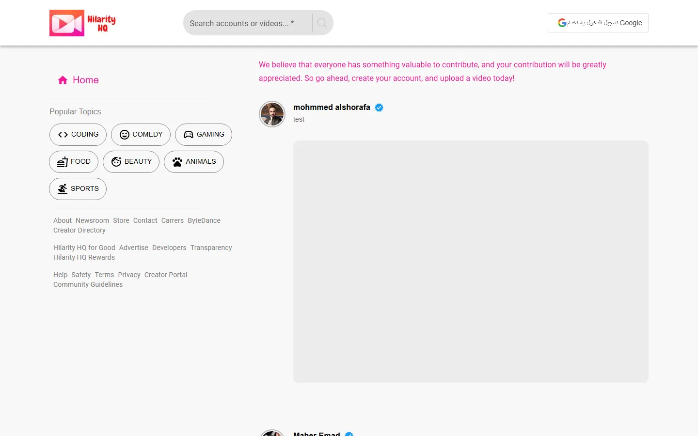

# Hilarity HQ

A platform for sharing videos, moments and daily memos. Sign in with Google, upload a short video with a caption and a
topic, and browse what everyone has posted.

**[Live demo](https://hilarity-hq.vercel.app)** · [More of my work](https://devmaheremad.com)



## What's inside
- **Next.js 13 with server-side rendering.** The feed and each video page load their data in `getServerSideProps`
  through the app's own API routes (`/api/post`, `/api/post/[videoId]`).
- **Google sign-in** with `@react-oauth/google`. The token is decoded on the client and the user is saved to Sanity
  through `/api/auth`.
- **Video upload.** MP4, WebM and Ogg only (other file types are rejected with a message), stored in Sanity with a
  caption and a topic.
- **Headless CMS.** Sanity Studio lives in `backend-hilarityhq/`, with schemas for users, posts and comments.
- **State.** Redux Toolkit with `redux-persist`, so the signed-in user survives a page reload.
- **UI.** Material UI 5 with a custom theme: topic links in the sidebar, profile pages and video detail pages.

## Stack
Next.js 13 · React 18 · TypeScript · Redux Toolkit · redux-persist · Material UI 5 · Sanity 3 · Google OAuth

## Run locally
```bash
git clone https://github.com/devmaheremad/hilarity-hq.git
cd hilarity-hq
npm install
npm run dev
```

Create a `.env.local` file with your own values (never commit it):

```
NEXT_PUBLIC_BASE_URL=http://localhost:3000
NEXT_PUBLIC_GOOGLE_API_TOKEN=your-google-oauth-client-id
NEXT_PUBLIC_SANITY_TOKEN=your-sanity-api-token
```

Sanity Studio: `cd backend-hilarityhq && npm install && npm run dev`.

## Next steps
The like and comment buttons are in the UI; saving them to Sanity is the next piece of work.

---

**Maher Almashharawi** · Senior Frontend Engineer (React, Next.js, TypeScript)
[devmaheremad.com](https://devmaheremad.com) · [Case studies](https://devmaheremad.com/case-studies/) · [LinkedIn](https://www.linkedin.com/in/devmaheremad) · hello@devmaheremad.com
